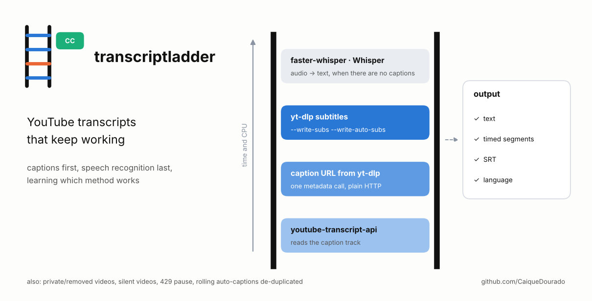
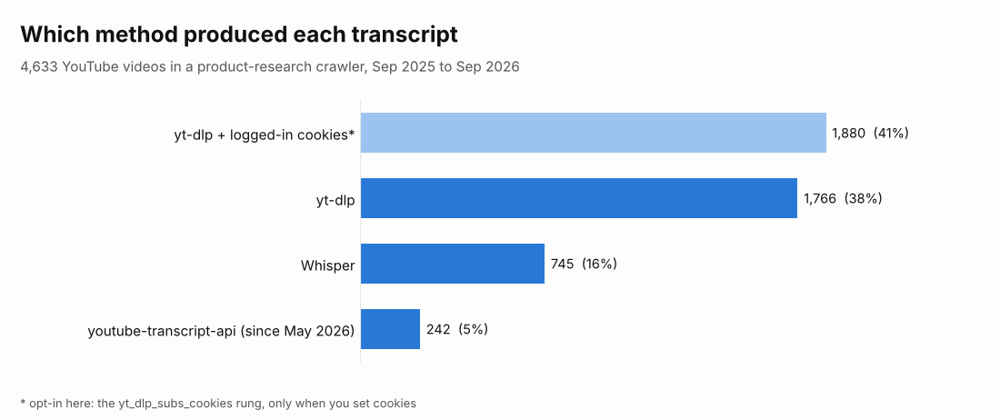
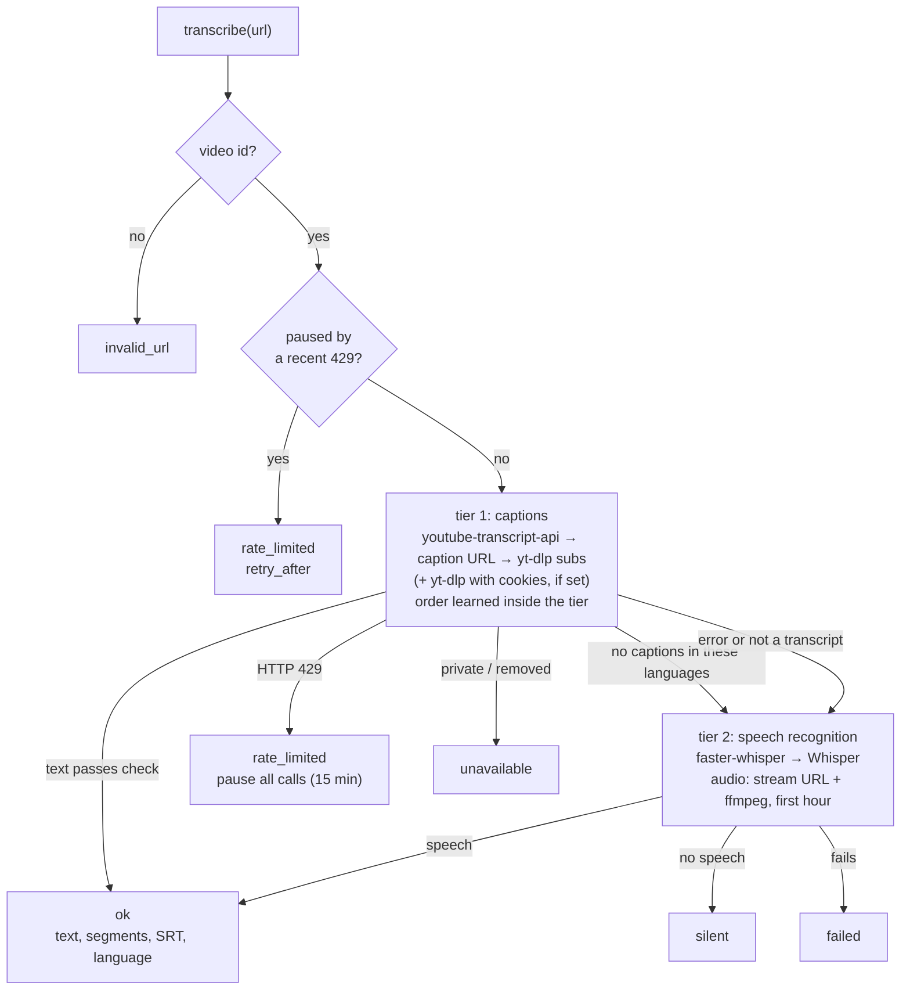
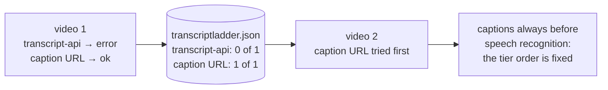

# transcriptladder

[](https://github.com/CaiqueDourado/transcriptladder/actions/workflows/tests.yml)
[](LICENSE)
[](pyproject.toml)

[Leia em português](README.pt-BR.md)



Get the transcript of a YouTube video with whichever method works today. The methods are tried in order:

1. **`youtube-transcript-api`**: reads the caption track directly.
2. **Caption URL from yt-dlp's metadata**: downloaded with plain HTTP.
3. **yt-dlp writing the subtitle file** itself (manual or automatic captions).
4. **faster-whisper or Whisper** on the audio, when the video has no captions at all.

Each method's success rate is remembered, so one that keeps failing moves down inside its tier. You get clean text, timed segments, SRT and the language.

```python
from transcriptladder import Transcriber

with Transcriber(languages=["pt", "en"], memory="transcriptladder.json") as t:
    r = t.transcribe("https://youtu.be/VIDEO_ID")

if r.ok:
    print(r.method, r.language)      # e.g. yt_dlp_subs pt
    print(r.text[:300])
    open("video.srt", "w").write(r.srt())
else:
    print(r.summary())               # e.g. silent via faster_whisper [caption_url:no_captions > ...]
```

## Where it comes from

The author's product-review site summarises what YouTube reviewers say about each product. That takes the transcript of thousands of videos, and no single method gets them all:

- the caption libraries break when YouTube changes its pages;
- yt-dlp needs a JavaScript runtime for some videos and hits HTTP 429 when called too fast;
- many videos have no captions at all.

This library is the transcript step of that crawler, rewritten as a package. In production it produced 4,633 transcripts:



- **yt-dlp** got 38% of them, and another 41% came from yt-dlp with the cookies of a logged-in YouTube session. That is the `yt_dlp_subs_cookies` rung here, off by default (see [Logged-in session](#logged-in-session-opt-in)). Without it, expect more of those videos to fall to Whisper or to fail.
- **Whisper** covered 16%, the videos with no captions.
- **youtube-transcript-api** was added in May 2026 and got 5%.

The shares come from the order the crawler used (cookies before plain yt-dlp), so they show which method was enough, not which one would fail.

Lessons that are now code:

- **The YouTube Data API does not give you other people's captions.** `captions.list` accepts an API key and returns the track id, and charges 50 quota units for it. `captions.download` then refuses: it requires OAuth from a user who can edit the video. The crawler paid that cost on every video until the method was removed. It is not a rung here.
- **Auto-captions repeat themselves.** YouTube's automatic VTT scrolls: each line appears again at the top of the next cue. A plain conversion prints every sentence two or three times. `to_segments` keeps each line once, with its timing.
- **A video is an id, not a URL.** The same video arrived as `watch?v=`, `youtu.be/`, `shorts/`, `m.youtube.com` and with `&t=30`. Matching by URL, products that pointed to a video already transcribed for another product stayed without it: 178 transcripts had to be copied by hand. `video_id()` normalises every form.
- **Silence is an answer.** When speech recognition runs and finds no speech, or only "[Música]", the result is `silent`, not a failure to retry forever.
- **Not everything that comes back is a transcript.** A consent page, a stack trace or raw JSON can arrive where captions were expected. `text.check` rejects them and the next rung is tried.

## How it works



How the order is learned across videos:



| Rung | Package | Tier | Default priority |
|---|---|---|---|
| `youtube_transcript_api` | `youtube-transcript-api` | 1 | 0.95 |
| `caption_url` | `yt-dlp` (command) + `requests` | 1 | 0.92 |
| `yt_dlp_subs` | `yt-dlp` (command) | 1 | 0.90 |
| `yt_dlp_subs_cookies` | `yt-dlp` + your cookies (opt-in) | 1 | 0.85 |
| `faster_whisper` | `faster-whisper` + `ffmpeg` | 2 | 0.80 |
| `whisper` | `openai-whisper` + `ffmpeg` | 2 | 0.65 |

The priority inside a tier mixes a moving average of recent results with the default (the same formula and memory file as [scrapladder](https://github.com/CaiqueDourado/scrapladder)). When a rung finds that the video has no captions in the requested languages, the other caption rungs are skipped.

**Audio for speech recognition.** ffmpeg reads the audio stream URL from the metadata and stops after `max_audio_seconds` (1 hour by default), so a 3-hour live stream does not download 3 hours. If that fails, `yt-dlp -x --download-sections` is used.

**Rate limits.** yt-dlp calls run one at a time. `min_interval` (10 s) separates videos. After a 429, every call returns `rate_limited` for `rate_limit_pause` (15 min) without touching YouTube.

## Install

```bash
pip install "transcriptladder[all] @ git+https://github.com/CaiqueDourado/transcriptladder"
# needs ffmpeg for speech recognition, and Node or Deno for yt-dlp on some videos
```

The extras are `api`, `ytdlp`, `whisper` (faster-whisper) and `openai-whisper`; `all` bundles the first three. Rungs whose package is missing are left out; `transcriptladder methods` lists them.

## Command line

```bash
transcriptladder methods
transcriptladder https://youtu.be/VIDEO_ID --lang pt,en          # plain text
transcriptladder VIDEO_ID OTHER_ID --srt --memory tl.json        # SRT, several videos
```

## Logged-in session (opt-in)

More and more often YouTube answers "Sign in to confirm you're not a bot", or asks to confirm age. yt-dlp's documented answer is to send the cookies of a logged-in session. In the author's crawler that path produced 41% of the transcripts.

```python
from transcriptladder import Transcriber, YtDlp

t = Transcriber(["pt", "en"], ytdlp=YtDlp(cookies="youtube-cookies.txt"))   # or cookies_from_browser="firefox"
```

```bash
transcriptladder VIDEO_ID --cookies youtube-cookies.txt
```

- **Off by default.** The `yt_dlp_subs_cookies` rung only exists when cookies are set.
- **Used only when needed.** It starts after the rungs without cookies, and the cookies are not used for metadata or audio. If the other rungs keep failing, the learned priority can move it up.
- **Use a secondary account.** YouTube can flag or restrict an account that fetches many videos.
- **Cookies are a password.** Keep the file out of git (`*cookies*.txt` is in `.gitignore`) and export it again when it expires.

## Scope

transcriptladder uses public tools as they are. It does not log in by itself, and it does not download the video, only captions or the audio needed for speech recognition.

`YtDlp(impersonate="chrome")` turns on yt-dlp's own browser impersonation, and `YtDlp(extra_args=[...])` passes arguments to every yt-dlp call as given. What you transcribe and how you use it is your responsibility; check YouTube's terms and the rights of the video owners.

## Limits

- Speech recognition on CPU is slow. Expect several minutes per hour of audio with faster-whisper's `base` model. Pick a bigger model or a GPU with `FasterWhisper(model="small", device="cuda")`.
- Speech recognition is given the first language in `languages`. A video in another language comes back as a poor transcript, not as an error.
- YouTube changes often. When every caption rung starts failing, update `yt-dlp` and `youtube-transcript-api` first.

## Related

- [scrapladder](https://github.com/CaiqueDourado/scrapladder): the same ladder for web pages (HTTP, browser TLS, headless browsers, scraping APIs).
- [pros-e-contras-ptbr](https://github.com/CaiqueDourado/pros-e-contras-ptbr): pros and cons from Portuguese reviews.

## License

[MIT](LICENSE) © Caique Dourado
