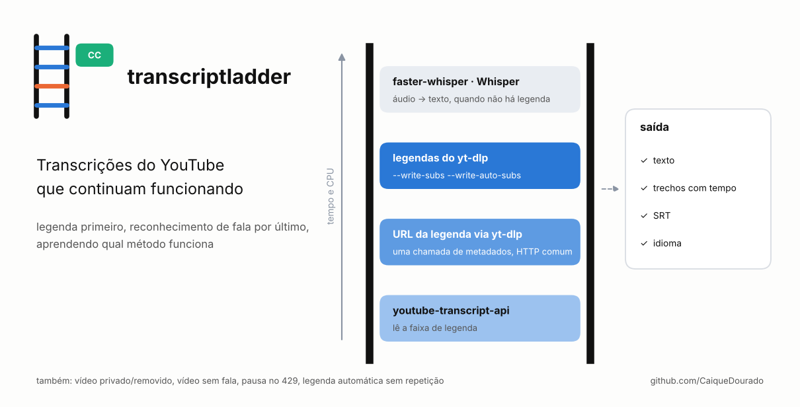
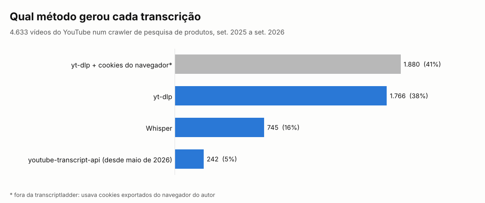
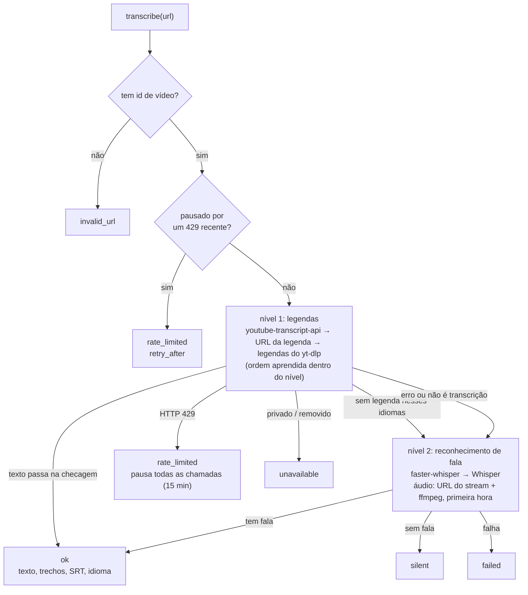
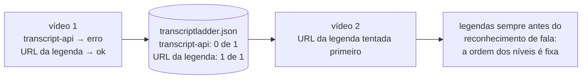

# transcriptladder

[](https://github.com/CaiqueDourado/transcriptladder/actions/workflows/tests.yml)
[](LICENSE)
[](pyproject.toml)

[Read in English](README.md)



Pega a transcrição de um vídeo do YouTube com o método que estiver funcionando hoje. Os métodos são tentados em ordem:

1. **`youtube-transcript-api`**: lê a faixa de legenda direto.
2. **URL da legenda nos metadados do yt-dlp**: baixada com HTTP comum.
3. **yt-dlp gravando o arquivo de legenda** ele mesmo (legenda manual ou automática).
4. **faster-whisper ou Whisper** no áudio, quando o vídeo não tem legenda nenhuma.

A taxa de acerto de cada método fica guardada, então um que vive falhando desce dentro do seu nível. Você recebe texto limpo, trechos com tempo, SRT e o idioma.

```python
from transcriptladder import Transcriber

with Transcriber(languages=["pt", "en"], memory="transcriptladder.json") as t:
    r = t.transcribe("https://youtu.be/VIDEO_ID")

if r.ok:
    print(r.method, r.language)      # ex.: yt_dlp_subs pt
    print(r.text[:300])
    open("video.srt", "w").write(r.srt())
else:
    print(r.summary())               # ex.: silent via faster_whisper [caption_url:no_captions > ...]
```

## De onde vem

O site de análises de produtos do autor resume o que os reviewers do YouTube dizem de cada produto. Isso exige a transcrição de milhares de vídeos, e nenhum método sozinho pega todos:

- as bibliotecas de legenda quebram quando o YouTube muda as páginas;
- o yt-dlp precisa de um runtime de JavaScript em alguns vídeos e leva HTTP 429 quando é chamado rápido demais;
- muitos vídeos não têm legenda nenhuma.

Esta biblioteca é a etapa de transcrição desse crawler, reescrita como pacote. Em produção, ela gerou 4.633 transcrições:



- **yt-dlp** pegou 38% delas, e outros 41% vieram do yt-dlp com cookies exportados do navegador do próprio autor. Essa variante não está nesta biblioteca (veja Escopo), então espere que mais desses vídeos caiam no Whisper ou falhem.
- **Whisper** cobriu 16%, os vídeos sem legenda.
- **youtube-transcript-api** entrou em maio de 2026 e pegou 5%.

As porcentagens vêm da ordem que o crawler usava (cookies antes do yt-dlp comum), então mostram qual método bastou, não qual falharia.

Lições que viraram código:

- **A YouTube Data API não entrega a legenda dos outros.** O `captions.list` aceita chave de API e devolve o id da faixa, cobrando 50 unidades de cota por isso. Depois o `captions.download` recusa: ele exige OAuth de um usuário que pode editar o vídeo. O crawler pagou esse custo em todo vídeo até o método ser removido. Ele não é um degrau aqui.
- **Legenda automática se repete.** O VTT automático do YouTube rola: cada linha aparece de novo no começo do trecho seguinte. Uma conversão simples imprime cada frase duas ou três vezes. O `to_segments` mantém cada linha uma vez só, com o tempo dela.
- **Vídeo é id, não URL.** O mesmo vídeo chegava como `watch?v=`, `youtu.be/`, `shorts/`, `m.youtube.com` e com `&t=30`. Casando por URL, produtos que apontavam para um vídeo já transcrito para outro produto ficavam sem a transcrição: 178 tiveram de ser copiadas à mão. O `video_id()` normaliza todas as formas.
- **Silêncio é resposta.** Quando o reconhecimento de fala roda e não acha fala, ou só "[Música]", o resultado é `silent`, não uma falha para tentar de novo para sempre.
- **Nem tudo que volta é transcrição.** Página de consentimento, stack trace ou JSON cru podem chegar no lugar da legenda. O `text.check` recusa e o próximo degrau é tentado.

## Como funciona



Como a ordem é aprendida de um vídeo para o outro:



| Degrau | Pacote | Nível | Prioridade padrão |
|---|---|---|---|
| `youtube_transcript_api` | `youtube-transcript-api` | 1 | 0,95 |
| `caption_url` | `yt-dlp` (comando) + `requests` | 1 | 0,92 |
| `yt_dlp_subs` | `yt-dlp` (comando) | 1 | 0,90 |
| `faster_whisper` | `faster-whisper` + `ffmpeg` | 2 | 0,80 |
| `whisper` | `openai-whisper` + `ffmpeg` | 2 | 0,65 |

A prioridade dentro de um nível mistura uma média móvel dos últimos resultados com o padrão (a mesma fórmula e o mesmo arquivo de memória da [scrapladder](https://github.com/CaiqueDourado/scrapladder)). Quando um degrau descobre que o vídeo não tem legenda nos idiomas pedidos, os outros degraus de legenda são pulados.

**Áudio para o reconhecimento de fala.** O ffmpeg lê a URL do stream de áudio que vem nos metadados e para depois de `max_audio_seconds` (1 hora por padrão), então uma live de 3 horas não baixa 3 horas. Se isso falhar, entra o `yt-dlp -x --download-sections`.

**Limite de requisições.** As chamadas ao yt-dlp rodam uma por vez. O `min_interval` (10 s) separa os vídeos. Depois de um 429, toda chamada devolve `rate_limited` por `rate_limit_pause` (15 min), sem tocar no YouTube.

## Instalação

```bash
pip install "transcriptladder[all] @ git+https://github.com/CaiqueDourado/transcriptladder"
# precisa do ffmpeg para o reconhecimento de fala, e de Node ou Deno para o yt-dlp em alguns vídeos
```

Os extras são `api`, `ytdlp`, `whisper` (faster-whisper) e `openai-whisper`; `all` junta os três primeiros. Degraus sem o pacote ficam de fora; `transcriptladder methods` lista o que está disponível.

## Linha de comando

```bash
transcriptladder methods
transcriptladder https://youtu.be/VIDEO_ID --lang pt,en          # texto
transcriptladder VIDEO_ID OUTRO_ID --srt --memory tl.json        # SRT, vários vídeos
```

## Escopo

A transcriptladder usa ferramentas públicas como elas são. Ela não:

- carrega cookies do seu navegador;
- faz login;
- baixa o vídeo em si, só a legenda ou o áudio necessário para o reconhecimento de fala.

`YtDlp(impersonate="chrome")` liga a imitação de navegador do próprio yt-dlp, e `YtDlp(extra_args=[...])` repassa argumentos a toda chamada do yt-dlp como vierem. O que você transcreve e como usa é responsabilidade sua; confira os termos do YouTube e os direitos dos donos dos vídeos.

## Limites

- Reconhecimento de fala em CPU é lento. Espere vários minutos por hora de áudio com o modelo `base` do faster-whisper. Para um modelo maior ou GPU: `FasterWhisper(model="small", device="cuda")`.
- O reconhecimento de fala recebe o primeiro idioma de `languages`. Um vídeo em outro idioma volta como uma transcrição ruim, não como erro.
- O YouTube muda com frequência. Quando todos os degraus de legenda começarem a falhar, atualize primeiro o `yt-dlp` e o `youtube-transcript-api`.

## Relacionados

- [scrapladder](https://github.com/CaiqueDourado/scrapladder): a mesma escada para páginas web (HTTP, TLS de navegador, navegadores headless, APIs de scraping).
- [pros-e-contras-ptbr](https://github.com/CaiqueDourado/pros-e-contras-ptbr): prós e contras a partir de reviews em português.

## Licença

[MIT](LICENSE) © Caique Dourado
